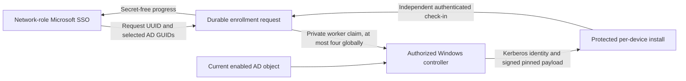

# Bulk diagnostic enrollment

The Device Performance table can select all currently eligible, visible AD computers and submit one enrollment request. Enrollment selection and measurement selection are independent. Enrollment installs the separate diagnostics helper and starts its lightweight check-ins; it does not queue measurements, arm rotation, activate GPO, change Alert approval, or modify MFA.

`POST /api/building-diagnostics/devices/bulk-enrollment` accepts `{requestId,adObjectGuids}` with 1–1000 unique GUIDs. Only an existing Fred network-role user session may originate a request. The server resolves names/domain from its current enabled AD roster. Reusing a request UUID with the same selection returns existing progress; changing its selection is rejected. `GET` at the same path plus `/:requestId` returns per-computer progress without credentials or worker claim nonces.

States distinguish queued, claimed, installing, installed, online, skipped, unreachable, and failed. Installed requires a running SYSTEM task receipt; online additionally requires a recent authenticated check-in after that claim and current matching AD authority. An existing or revoked identity is preserved. A configured endpoint is skipped rather than overwritten. Interrupted claims fail for review after fifteen minutes and are never automatically requeued or rotated.

The worker-only `.../worker/claim`, `.../worker/provision`, and `.../worker/result` endpoints use the existing dedicated private worker authority. Credentials are issued once after endpoint preflight; only their hashes persist on Fred. Unknown credential delivery must be reviewed rather than replayed. The installer stores the endpoint credential with machine DPAPI and SYSTEM/Administrators permissions. No worker or endpoint token belongs in arguments, logs, public shares, SYSVOL, Git, browser bulk responses, or receipts.

The controller is `Invoke-BulkDiagnosticsEnrollment.ps1`, run with elevated PowerShell 7.2+ on the reviewed domain operator host. Supply the existing protected machine-DPAPI worker credential path, reviewed HTTPS Fred origin, and verified RC1 payload directory. Default execution claims at most four targets once; `-Watch` polls for subsequent user-selected requests. Payload files are pinned by SHA256 and the approved timestamped Authenticode signer. DNS/AD authority is pinned to `ad-sc00.sccc.edu` (`10.0.0.46`) through `10.40.1.77`; endpoint management uses exact private AD FQDNs and Kerberos. Per-host sanitized receipts stay in the protected receipt directory. Staging directories and the exclusive one-time input file are created atomically with private ACLs. Unsafe existing shared installation parents fail before credential issuance; only a missing shared parent is created securely. Helpers receive the already configured server-authoritative external origin while sustained permission stays false; configuring that existing target does not queue any measurement.

The new controller checks the actual installed configuration location, `C:\ProgramData\SCCC\Diagnostics\config.json`. The earlier publisher's guard has been corrected to the same location. Existing helper task/configuration is retained; no automatic update or credential recovery is performed.

Execution policy is checked before credentials or staging: MachinePolicy `Restricted` holds; `AllSigned` or `Undefined` requires the existing approved LocalMachine TrustedPublisher certificate; `RemoteSigned` or `Unrestricted` can allow the locally copied approved signed payload under their existing policy. Other/unknown policies hold for review. SYSTEM UserPolicy remains explicitly unknown rather than inferred from the operator's remoting session. The controller never imports publisher trust or changes execution policy, and actual SYSTEM task/check-in verification remains required.

Prepared source is separate from activation. Do not mark a fleet enrolled merely because its request is queued or an identity was issued. Verify actual per-host receipts and server check-ins. Existing measurement, automatic scheduler, sustained-transfer, Alert and revocation controls remain authoritative. A code rollback restores the reviewed API/UI backup; endpoint helpers and issued identities require explicit reviewed uninstall/revocation rather than silent bulk deletion.

Validation: targeted HTTP/selection tests cover session/worker separation, strict payloads, disabled feature gates, immutable GUID selection and freshness. Disposable PostgreSQL tests require `BUILDING_DIAGNOSTICS_TEST_DATABASE_URL` with a database named `diagnostics_bulk_test_*`; they cover UUID idempotency, four global claims, one-time credential delivery, revocation, authenticated online status and interrupted delivery.

`release-bulk-enrollment.py prepare <private-release-directory>` builds API and frontend from a fresh source-only live snapshot plus the five reviewed source overrides. It pins build inputs and existing source/artifact hashes, uses private candidate caches, and copies no environment, token, state or database files. `check` is read-only. Root executes `apply` only after reviewing the frozen manifest: source and original API/index artifacts are backed up, drift stops the release, only generated frontend assets/index are installed, and existing public downloads/assets remain. Service `sccc-api.service` and canonical diagnostics URL must pass health/auth/hash checks; failure restores validated original bytes with bounded startup checks. `rollback` refuses unknown intervening changes or missing/corrupt backups. No release mode creates an enrollment request or activates an endpoint.

Apply and rollback require the approved `sudo`/root identity before any live write. The manifest pins original owner/group/modes and parent permissions; replacements retain them without granting directory access. A failed first replacement performs no rollback write or service restart. `reuse <new-private-release-directory> --reuse-from <reviewed-prior-release>` may reuse an immutable candidate only after its exact live/candidate hashes match, then captures fresh original metadata; it never overwrites a previously attempted release.

## Authorized-sender performance handoff, 2026-10-27

Deployed bounded multi-computer entry through `adObjectGuids` (comma-separated, at most 100 valid AD GUIDs). GUIDs are deduplicated, the inventory view is scoped to that group, and only currently eligible computers are selected. Missing/ineligible identities are counted; malformed input is rejected as a whole. The existing single `adObjectGuid` path retains its original selected/unenrolled notices. Opening either handoff starts no enrollment or measurement.

The isolated full Linux frontend build passed all 21 browser regressions against its actual SPA with intercepted APIs, including existing SSO/role/single-entry behavior and the nine bulk-selection/handoff/online-status cases. The prepared frontend-only release pins 370 source inputs, API artifact hashes/PID and original source/index metadata; only generated assets/index and the reviewed UI source can change. Existing public downloads remain; no API restart or database operation is requested. The parent applied the frontend-only release and verified both HTTPS origins while API PID 391676 remained unchanged. The signed-in sender handoff scoped 76 unique AD computers and selected 68 eligible receivers, honestly showing 8 ineligible and 0 absent; no enrollment or measurement was started. Existing downloads remained in place.
