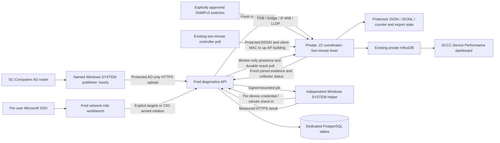

# SCCC Device Performance — 2026-10-25 release

This feature connects Fred's network workbench, independently provisioned Windows diagnostics helpers, the trusted AD roster, and private network telemetry. It does not replace the public Windows/Store app, the separate GPO probe 0.1.3 paging protocol, emergency receiver approval, sender authorization, or per-user MFA configuration.

## Operational handoff

This is the current handoff snapshot. Later deployment evidence should update this table rather than turn a staged component into a live claim.

| Component | Verified/reported state |
| --- | --- |
| Fred API/workbench | Named pilot code deployed; 675 AD computer records imported. Inventory is not a count of online helpers or installed alert receivers. |
| Microsoft SSO | Root verified automatic CIO sign-in and selection of LP-F6K6S64 through the real workbench. |
| LP-F6K6S64 | Independent helper 1.1.0 running with a recent authenticated check-in. Root requested one 5 MiB external pilot through the real UI. RSAT-ready alternate AD publisher is being prepared here; hourly publisher activation/read-back remains separate. |
| LP-AA152MB-01 | Helper and hourly AD publisher staged; local UAC was cancelled, so their activation is pending. A previously imported roster does not prove hourly refresh. |
| Private `.22` collector / wireless companion | Collector 1.2.1 read back. First full cycle succeeded with degraded SNMP coverage: 1/39 switches, zero port observations, 1,037 wireless observations including 495 client-MAC associations. It pulled/exported two measurement reports through cursor 2 and wrote 675 AD presence points. Influx/Grafana query and dashboard read-back remain separate checks. |
| Wi-Fi client-MAC resolver | Two guarded backend source files and rebuilt API applied at 20:10 UTC; health passed, anonymous worker projection denied, canonical sign-in unchanged. Backup: `/home/scccadmin/fred-device-performance-20261025/wifi-mac-backup-20261025T201007Z`. |
| Fleet / load controls | No fleet rollout or emergency alert authorized by this release. Scheduler deployment and sustained external gates remain off; automatic rotation requires the separate persisted CIO arm. |

## Design

**User sign-in and device reporting are separate identities.** The workbench uses Fred's existing OIDC sign-in, IT access gate and `cio`, `network`, or `network_engineer` roles. Only CIO may save scheduler settings. The alert sender's `alerts.send` token does not grant Fred network authority. Native sender navigation can preselect a verified AD object GUID; opening it never queues a measurement.

Entry is `https://insights.sccc.edu/network/diagnostics?sso=1`. The client first follows the validated `loginOrigin` returned by `/api/auth/entra/status`, then starts existing Microsoft OIDC once. The registered callback is currently `https://app-server2.centralus.cloudapp.azure.com/api/auth/entra/callback`. Origin-bound state cookies and the allowlisted diagnostics return path remain together. Sign-in errors stop automatic retries. No callback registration or role expansion was needed.

The Windows helper runs as SYSTEM and reports independently of an interactive user's browser session. It receives its own hashed-on-server device identity; local credentials use DPAPI LocalMachine and SYSTEM/Administrators ACLs. It receives no SNMP credential, private worker credential, alert authority or MFA seed. The separately authorized AD publisher is an exception: its protected DPAPI worker credential permits the trusted private-worker API surface, and is confined to the named publisher rather than distributed with the receiver.

## Evidence and measurements

- Every complete AD roster row remains visible, including disabled and not-enrolled computers. Enabled immutable AD GUID/name/domain must match the provisioned identity; directory authority expires after 24 hours. Online means an authenticated helper check-in within three minutes. A registered name alone proves neither AD membership nor physical coverage.
- Current building requires fresh, unambiguous network evidence within ten minutes. Learned unicast FDB entries must map through the bridge table to up physical access ports. Trunks, LAGs, uplinks and LLDP network peers are excluded. Trusted controller client-MAC associations can resolve a Wi-Fi computer even when Windows privacy permissions prevent BSSID access. Invalid/multicast MACs are rejected. Conflicting or absent evidence remains ambiguous/unknown.
- Optional exact user/desk-phone associations represent an assigned office, not a roaming computer's current location. They are not fabricated when unavailable.
- Operators can choose arbitrary eligible devices, or one random eligible device per currently identified building. Explicit unlocated measurements remain uncredited to a building. AD GUID preselection does not enroll or approve a machine.
- Fred-path jobs transfer 8 MiB each direction and make five bounded HTTPS requests. One persisted lease and a 30-second cooldown serialize load across API instances. HMAC proofs, expiry, device binding and server transfer receipts constrain execution. The helper exposes no arbitrary shell/URL facility.
- External quick jobs download 5 MiB from the configured HTTPS origin on explicitly selected capable helpers. Sustained range downloads require the separate server gate, protected endpoint policy, one selected device, a future schedule and explicit data-budget confirmation. They remain off. HTTPS Mbps, SNMP link speed and utilization are different measures; none alone certifies a 10 Gb Internet path.
- Automatic rotation runs only Fred-path tests. Deployment allow **and** persisted CIO arm must both be true. The interval is 60–1440 minutes, default 360. Settings revisions cancel/fence superseded automatic jobs at claim, status and transfer checks, including after restart. Manual network-role jobs remain independent. Queue and control actions are audited transactionally.

## Private collection and reporting

`coordinator_worker.py` uses the existing private SNMP module without starting its listener. It intersects the sanitized `name,ip,building` CSV with explicitly mapped SNMP-profile IPs; it does not expand to other targets or change device configuration. At most four isolated targets run concurrently, with a 210-second collection bound, a 285-second cycle alarm and service timeout. A persisted next-target index prevents slow early targets from starving later buildings.

The target/profile map is metadata, not the credential file: its reader permits the existing root-owned `0640` contract while rejecting symlinks, non-root owners, writable group/other modes and oversized files. Private SNMP profile permissions and contents remain unchanged.

The first-cycle SNMP gap is only partly diagnosed. CAH's minimal walks timed out, while SW-BB returned interface/bridge rows promptly but its GETNEXT FDB walks reached the diagnostic process cap. A single read-only bulk request then returned ten port and ten status rows in 0.108 seconds. The narrow follow-up uses GETBULK only for the two FDB tables, with the existing private profile, a fifteen-second/table deadline and a 12 MiB output cap. Its full SW-BB candidate check completed successfully in 9.669 seconds, but produced no eligible access ports. This candidate was tested without changing installed 1.2.1. No device configuration or edge policy was relaxed; wired coverage remains degraded until the versioned worker and actual port evidence are verified.

Counter presence is read from actual SNMP responses, preserving true zero separately from missing values. Rates require actual consecutive octet samples and monotonic timing, compatible counter width/collector boot/switch uptime/discontinuity, and a known link ceiling. Counter resets or implausible rates produce missing rates. Earlier read timestamps are not refreshed by a later slow walk.

The wireless companion writes root-protected `/var/lib/sccc-wireless-metrics/diagnostics-observations.json`. The client-MAC follow-up adds current controller associations to known up APs, without usernames or client IPs. Missing/stale optional wireless data produces degraded collection; it does not invent location or discard successful switch evidence.

Worker contracts are separate from user sessions:

| Endpoint under `/api/building-diagnostics` | Authority / purpose |
| --- | --- |
| `GET/POST /ad-inventory` | Private worker; current complete nonempty AD snapshot. AD-only uploads preserve network evidence under the same transaction lock. Older racing snapshots are rejected. |
| `POST /inventory` | Private worker; fresh joined network observations, assignments and explicit collector status. |
| `GET /reporting-snapshot` | Private worker; allowlisted AD/device state and readiness, excluding user/MAC/token/audit/result details. |
| `GET /reports?after=…` | Private worker; durable ordered measurement cursor. |
| `GET /overview`, device controls, manual jobs | Existing Fred network roles; device secrets returned once with `no-store`. |
| `GET/PUT /settings` | Network roles read; CIO writes strict bounded settings. |
| `/agent/*` | Independent device credential, constrained to its own identity/jobs. |

`.22` stores protected inventory, presence, counters, results JSON/JSONL and Influx acknowledgement state. Measurement points retain Fred's original `recordedAt`; presence points retain the original reporting snapshot time. Stable identities/timestamps and acknowledgement-before-cursor advancement make uncertain retries idempotent. Presence metrics contain GUID/computer/building and actual booleans, not usernames, MACs or tokens. Unknown AD-enabled state remains explicitly unknown.

Dashboard UID is `sccc-device-performance`, using existing Influx datasource `bf0gpakqau6tcc`. It includes endpoint throughput, access-port traffic/error counters, collector coverage, current online/enrolled counts by building and device state. Current presence panels require data within fifteen minutes; no data remains No data. Generated dashboard JSON still requires import/provisioning and live query read-back before calling Grafana verified.

## Operation and rollback

Keep deployment scheduler and sustained gates off until deliberately enabled. The separately persisted scheduler arm defaults false. The pilot may enable diagnostics reporting without enabling either load gate. Ordinary helper provisioning and the dedicated AD publisher remain internal operations; no shared worker/device secret belongs in SYSVOL, the public website or an installer command line. No AD forest schema change is part of this feature.

Before each update compare live affected source/build hashes, back up the affected release, and restart only managed `sccc-api`. The private collector installer generates its five-minute timer but does not enable it automatically; review one cycle before enabling recurring collection. Versioned follow-ups require a guarded atomic `current` symlink switch and all Python import dependencies, including `build_inventory.py`.

Rollback disables scheduler/reporting as appropriate, stops the private timer/helper, restores the backed-up code/build and restarts the existing service. Retain database/output evidence and provisioned identities; do not drop tables or alter alert/MFA deployment to roll back network diagnostics. Wireless rollback restores the exact backed-up source/override and the previous image.

## Verification and daily change tally

- Backend progression: 52 focused tests passed, then 54 after AD-only snapshot/concurrency additions (19 disposable PostgreSQL cases). The current worker-projection route suite passed 20 tests. The client-MAC follow-up passed its two focused regressions, including real isolated PostgreSQL. These are individual checkpoints, not a claim that all current tests were rerun together.
- Python: 29 tests passed on Linux, including child-process termination, `0640` metadata and bulk scope/output/deadline regressions. Windows runs 29 tests with 27 passing and the two Linux-only cases skipped. SNMP/Influx fixtures use synthetic data; the separately identified SW-BB checks were real bounded read-only observations.
- UI/SSO agent reported three navigation/helper unit tests, six canonical-origin auth tests and twelve synthetic browser fixtures passing. Linux API/UI production builds passed. Existing broad typecheck failures and frontend bundle warnings remain outside this feature; the repository is not claimed type-clean.
- Real checks include the named helper check-in, root's CIO SSO/selection and one explicitly queued 5 MiB external pilot, guarded API health/authentication read-back, and the first private cycle with 675 presence points/two exported reports. Matching individual measurement results, Influx queries, Grafana read-back, hourly AD refresh, reboot persistence and fleet coverage require their own evidence.

Daily additions: operator workbench and native entry; persisted scheduling/audit/readiness; AD-only publisher exchange; private SNMP/controller correlation; protected presence/result export and Influx/Grafana generation; guarded client-MAC resolver update. No fleet GPO, emergency alert or MFA migration was performed by these changes.
