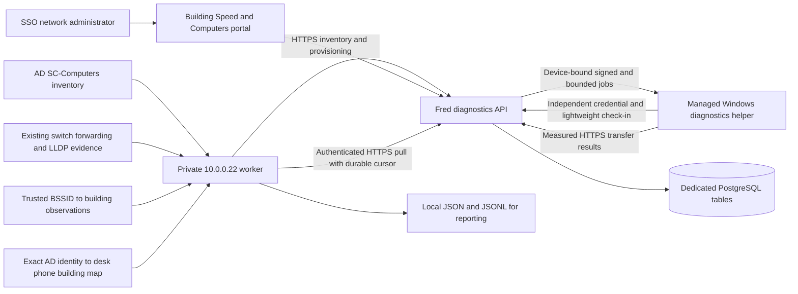

# Building speed and AD computer reporting

Implementation date: 2026-10-25. This is an independent diagnostics feature for Fred. It does not modify SCCC Alert enrollment, alert delivery, live approval, MFA keys, Store installers, or the four authorized emergency senders.

## Data flow



Every AD computer appears in the imported inventory. Enrollment and recent authenticated check-in are separate facts. A roster record does not prove that a receiver is installed or online. The helper reports once per minute; speed tests run only when Fred issues a job. No endpoint receives SNMP credentials, a worker credential, alert authority, or another user's MFA data.

## Building and performance meaning

Fresh unambiguous endpoint MAC to access-switch/port observations or Wi-Fi BSSID observations establish a current building. Uplink/trunk entries and conflicting buildings cannot establish location. Desk phone and explicit user mappings establish an **assigned office**, not the physical location of a roaming laptop. The adapter requires an explicit qualified AD identity join; it never joins display names. Missing, stale, or conflicting evidence remains visible.

Automatic measurements rotate among online, AD-verified computers with current network-confirmed building evidence. One persisted lease permits one load test at a time across API instances. Building intervals default to six hours, with a cooldown between tests. Administrators can select individual computers or choose one random eligible computer per building. Unlocated manual measurements must not be credited to a physical building.

Measurements are capped 8 MiB transfers in each direction plus five HTTPS requests. The helper enforces a hard 32 MiB ceiling, operation deadlines, job expiry, device binding, and an HMAC proof using its independent device credential. Fred also enforces single-use operations and verifies transfer receipts before accepting a successful result. Only fixed same-origin paths are executable; there is no arbitrary command or target URL facility.

The target is **Fred HTTPS path**. Mbps is transferred bytes divided by elapsed time, including the endpoint and HTTPS path constraints. Link rate, SNMP utilization, and this bounded sample do not prove maximum 10 Gb campus Internet capacity. Request loss is failed HTTPS probes, not ICMP packet loss. No recent measurement is displayed as missing, never as zero or a healthy building.

## Feature gates and identities

Fred environment:

```text
BUILDING_DIAGNOSTICS_ENABLED=false
BUILDING_DIAGNOSTICS_SCHEDULER_ENABLED=false
BUILDING_DIAGNOSTICS_WORKER_TOKEN=<dedicated random secret of at least 32 characters>
```

Both flags default off. When reporting is enabled, the automatic scheduler can remain off for a named pilot. Keep the worker token in a protected server environment file and the private worker's protected credential file; never in Git, SYSVOL, endpoint config, shell history, or query strings. Device provisioning returns a new random diagnostics token once. Fred stores its hash. The Windows installer stores that token with machine DPAPI and administrator/SYSTEM-only ACLs.

Portal: `https://insights.sccc.edu/network/diagnostics`. Fred's existing Microsoft sign-in and `cio`, `network`, or `network_engineer` authorization apply. Worker authentication is separate from Fred sessions and cannot call administrator pages or emergency-alert APIs.

Dedicated tables are created lazily when the feature is enabled and first used: `building_diagnostics_inventory`, `building_diagnostics_devices`, `building_diagnostics_jobs`, `building_diagnostics_reports`, and `building_diagnostics_audit`. The feature does not alter the AD forest schema.

Network administrators or the dedicated worker can revoke a device with `POST /api/building-diagnostics/devices/:deviceId/revoke` or recover its credential with `POST /api/building-diagnostics/devices/:deviceId/rotate`, each with a JSON `reason`. Rotation returns a new token once and checks the immutable AD GUID against the current roster, including legitimate computer renames. Both operations cancel outstanding jobs and create audit records. Neither operation accepts a caller-supplied replacement identity.

## Private worker and trusted sources

1. Export the real enabled and disabled computer roster from the exact `SC-Computers` distinguished name with `Export-AdDiagnosticsInventory.ps1`. `adObservedAt` records the actual AD query time; republishing a cached file does not refresh that authority. A complete snapshot is required. AD authority expires after 24 hours without a fresh export.
2. Use `build_inventory.py` to combine that roster with existing individual forwarding entries in `collect_switch_ports.py` aggregate output, trusted Wi-Fi observations, and optional exact AD-to-Webex owner mappings. Configure `edge-policy.example.json` from the actual campus port inventory. Unknown or ambiguous ports are excluded. This adapter does not query switches itself.
3. Configure `worker.env.example` with the public Fred origin and protected inventory/output paths. The worker publishes inventory and pulls results with an atomic durable cursor. JSONL is derived from the durable deduplicated snapshot; restart does not create duplicate report IDs. The timer consumes an already joined inventory file: the operator must arrange a current AD export and current switch/AP source before running `build_inventory.py`. A nightly forwarding snapshot is insufficient for current building location; use an approved read-only collection cadence within the resolver's ten-minute freshness limit.
4. Install the supplied systemd service/timer on private `10.0.0.22` only after reviewing paths and credentials. No inbound route to `.22` is necessary. The supplied files do not enable a timer automatically.

The current implementation exports deduplicated JSON/JSONL. It does not claim an InfluxDB/Grafana dashboard is already wired. The output is available for the existing `.22` reporting pipeline to consume.

## Named workstation pilot and GPO preparation

The Windows helper is in `windows/`; see its README for exact installation, signing, validation, activation, and removal commands. Keep it separate from the consumer website/Store installer.

1. Verify the intended pilot's enabled AD GUID, computer name, and DNS domain using the trusted operator export. Import that current inventory before provisioning.
2. Provision only named pilots using Kerberos remote execution. The worker secret remains on the operator host. No shared fleet enrollment token is distributed. Preserve each endpoint's protected configuration; duplicate provisioning is refused.
3. Authenticode-sign the helper module and agent script with the approved SCCC code-signing identity. Activation pins the expected signer thumbprint and validates source and installed signatures. An unsigned copy can be staged but cannot be activated.
4. Stage the disabled scheduled task and confirm the ACL and DPAPI configuration. Then explicitly activate the signed helper for the named pilot.
5. Confirm one stable device ID and AD membership, recent check-in, actual switch/AP building, and no alert/MFA changes. With the automatic scheduler off, request one measurement and verify a report reaches Fred and the private worker's local output.
6. Reboot/sign out to check helper persistence. Verify normal alert reception separately without sending a live emergency alert.
7. Only after accepting the pilot, activate the internal GPO rollout for the approved workstation OU, excluding servers/domain controllers. Device secrets must be provisioned through Kerberos, never placed in SYSVOL. Automatic measurements can then be armed independently.

## Deployment and rollback

Use the live Fred source as the authoritative baseline. The isolated implementation branch contains a separate baseline reconciliation commit; do not merge or deploy that reconciliation wholesale over another active development branch. The feature deployment consists only of the new diagnostics modules/page, route and navigation additions, and the built API/frontend artifacts.

Before deployment, verify source hashes against the recorded live baseline, back up the affected source files and both built directories, and review any intervening changes. Deploy with both feature flags off first. Restart `sccc-api` through the normal privileged service-control path, verify its health, verify unauthenticated diagnostics requests are rejected, and verify the signed-in page reports staged status. No diagnostic tables, load tests, task activation, GPO links, or network-device changes are needed for that initial deployment.

Rollback: turn both flags off, restore the backed-up API/frontend artifacts and affected source files, restart the service normally, and verify the original health/page. Keep diagnostic tables and output as evidence; do not drop tables or delete endpoint identities during rollback. The Windows uninstall script removes only this feature's task and files.

## Verification

Run the focused backend Vitest suites, worker unittest suite, Windows offline tests under Windows PowerShell 5.1, and the synthetic Playwright page tests. Browser fixtures must mock API access and must never queue real campus jobs. Build in Linux, matching Fred; this repository intentionally excludes several Windows native build dependencies. Record actual results in the change note, including any broader pre-existing typecheck failures. Fleet coverage, switch location, and end-to-end `.22` delivery require the named pilot and must not be inferred from unit tests.
