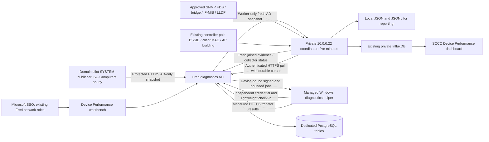

# Building speed and AD computer reporting

Implementation date: 2026-10-25. This is an independent diagnostics feature for Fred. It does not modify SCCC Alert enrollment, alert delivery, live approval, MFA keys, Store installers, or the four authorized emergency senders.

Current implementation, deployment boundaries, verification and handoff status: [Device Performance release, 2026-10-25](DEVICE-PERFORMANCE-20261025.md). Earlier RC notes describe preparation milestones, not current fleet coverage.

## Data flow



Every AD computer appears in the imported inventory. Enrollment and recent authenticated check-in are separate facts. A roster record does not prove that a receiver is installed or online. The helper reports once per minute; speed tests run only when Fred issues a job. No endpoint receives SNMP credentials, a worker credential, alert authority, or another user's MFA data.

## Building and performance meaning

Fresh unambiguous endpoint MAC to access-switch/port observations or trusted controller BSSID/client-MAC observations establish a current building. Controller client-MAC associations also work when Windows SYSTEM cannot read BSSID because of location privacy permissions. Uplink/trunk entries and conflicting buildings cannot establish location. Optional exact desk-phone/user mappings establish an **assigned office**, not a roaming laptop's physical location; that optional source is not fabricated when absent. Missing, stale, or conflicting evidence remains visible.

Automatic Fred-path measurements rotate among online, AD-verified computers with current network-confirmed building evidence. The deployment scheduler gate and the persisted CIO arm must both permit execution. The CIO can save a 60–1440-minute interval (default six hours); settings revisions fence old automatic work, including after restart. One persisted lease permits one load test at a time across API instances, with a 30-second cooldown. Network administrators can select arbitrary eligible computers or choose one random eligible computer per building. Unlocated manual measurements are not credited to a physical building. Manual external quick/sustained tests are separately bounded; the automatic scheduler does not start external tests.

Measurements are capped 8 MiB transfers in each direction plus five HTTPS requests. The helper enforces a hard 32 MiB ceiling, operation deadlines, job expiry, device binding, and an HMAC proof using its independent device credential. Fred also enforces single-use operations and verifies transfer receipts before accepting a successful result. Only fixed same-origin paths are executable; there is no arbitrary command or target URL facility.

The target is **Fred HTTPS path**. Mbps is transferred bytes divided by elapsed time, including the endpoint and HTTPS path constraints. Link rate, SNMP utilization, and this bounded sample do not prove maximum 10 Gb campus Internet capacity. Request loss is failed HTTPS probes, not ICMP packet loss. No recent measurement is displayed as missing, never as zero or a healthy building.

## Feature gates and identities

Fred environment:

```text
BUILDING_DIAGNOSTICS_ENABLED=false
BUILDING_DIAGNOSTICS_SCHEDULER_ENABLED=false
BUILDING_DIAGNOSTICS_EXTERNAL_SUSTAINED_ENABLED=false
BUILDING_DIAGNOSTICS_WORKER_TOKEN=<dedicated random secret of at least 32 characters>
```

Reporting defaults off; scheduler deployment and sustained external tests remain off for the pilot, and the persisted scheduler arm defaults false. Keep the worker token restricted to Fred, private `.22`, and the specifically authorized AD publisher's protected DPAPI configuration; never in Git, SYSVOL, ordinary endpoint config, shell history, or query strings. Device provisioning returns an independent random diagnostics token once. Fred stores its hash. The Windows installer stores that device token with machine DPAPI and administrator/SYSTEM-only ACLs.

Portal entry: `https://insights.sccc.edu/network/diagnostics?sso=1`. Before starting OIDC it moves to the HTTPS origin of Fred's already registered callback, as returned by `/api/auth/entra/status`; state cookies and the allowlisted diagnostics return path stay on that origin. Microsoft sign-in starts automatically once, and errors stop the flow instead of looping. Fred's existing `cio`, `network`, or `network_engineer` roles apply; only CIO changes automatic scheduling settings. The alert sender's Entra token does not grant Fred network authority. Worker authentication cannot call administrator pages or emergency-alert APIs.

Dedicated tables are created lazily when enabled and used: `building_diagnostics_inventory`, `building_diagnostics_devices`, `building_diagnostics_jobs`, `building_diagnostics_reports`, `building_diagnostics_audit`, and `building_diagnostics_settings`. The feature does not alter the AD forest schema.

Network administrators or the dedicated worker can revoke a device with `POST /api/building-diagnostics/devices/:deviceId/revoke` or recover its credential with `POST /api/building-diagnostics/devices/:deviceId/rotate`, each with a JSON `reason`. Rotation returns a new token once and checks the immutable AD GUID against the current roster, including legitimate computer renames. Both operations cancel outstanding jobs and create audit records. Neither operation accepts a caller-supplied replacement identity.

## Private worker and trusted sources

1. The signed AD publisher is restricted to the two authorized pilots `LP-AA152MB-01` and `LP-F6K6S64`. As SYSTEM it reads `OU=SC-Computers,DC=sccc,DC=edu` and publishes complete enabled/disabled computer snapshots at startup and hourly. It requires its separate privileged installation step; RSAT-ready `LP-F6K6S64` is the alternate when local UAC blocks `LP-AA152MB-01`. `adObservedAt` is the actual directory query time; AD authority expires after 24 hours. `.22` needs no domain join, AD password or keytab.
2. `coordinator_worker.py` fetches `/ad-inventory`, combines current private evidence, publishes `/inventory`, pulls `/reporting-snapshot`, then drains measurements through `/reports` with the existing durable cursor. AD-only uploads and joined snapshots share a transaction lock; an older racing AD snapshot is rejected instead of replacing newer directory authority.
3. `private_snmp_collector.py` intersects the sanitized `name,ip,building` CSV with explicit private SNMP-profile IPs. At most four isolated switch workers collect concurrently within a bounded cycle. Learned unicast Q-BRIDGE FDB entries must map through the bridge table to up physical access ports; trunk/LAG/uplink/network-neighbor ports are excluded. Unknown stays unknown. Actual consecutive counters, monotonic times, boot/discontinuity checks and a link ceiling govern optional traffic rates.
4. The existing two-minute wireless controller poll writes protected `/var/lib/sccc-wireless-metrics/diagnostics-observations.json`. Only current known up-AP building associations and valid BSSID/client MACs are used; no client username or IP is exported. Missing/stale Wi-Fi evidence makes collection degraded.
5. The private installation generates a five-minute coordinator service/timer. Root-owned environment/state files contain its credentials and durable JSON/JSONL, presence and counter snapshots. Existing Influx credentials are reused privately. Report metrics retain original timestamps and stable identities, and the acknowledged Influx cursor makes retries idempotent. Dashboard JSON uses UID `sccc-device-performance` and the existing datasource UID. No inbound `.22` route or endpoint SNMP credential is required. Installation and generated dashboard files do not by themselves prove a successful collection or Grafana import.

## Named workstation pilot and GPO preparation

The Windows helper is in `windows/`; see its README for exact installation, signing, validation, activation, and removal commands. Keep it separate from the consumer website/Store installer.

1. Verify the intended pilot's enabled AD GUID, computer name, and DNS domain using the trusted operator export. Import that current inventory before provisioning.
2. Provision only named helpers using the authorized operator path. Ordinary receiver computers get their own diagnostics identity, not the worker credential. Only the separately authorized AD publisher receives protected publisher authority. Preserve each endpoint's configuration; duplicate provisioning is refused.
3. Authenticode-sign the helper module and agent script with the approved SCCC code-signing identity. Activation pins the expected signer thumbprint and validates source and installed signatures. An unsigned copy can be staged but cannot be activated.
4. Stage the disabled scheduled task and confirm the ACL and DPAPI configuration. Then explicitly activate the signed helper for the named pilot.
5. Confirm one stable device ID and AD membership, recent check-in, actual switch/AP building, and no alert/MFA changes. With the automatic scheduler off, request one measurement and verify a report reaches Fred and the private worker's local output.
6. Reboot/sign out to check helper persistence. Verify normal alert reception separately without sending a live emergency alert.
7. Only after accepting the pilot, activate the internal GPO rollout for the approved workstation OU, excluding servers/domain controllers. Device secrets must be provisioned through Kerberos, never placed in SYSVOL. Automatic measurements can then be armed independently.

## Deployment and rollback

Use the live Fred source as the authoritative baseline. The isolated implementation branch contains a separate baseline reconciliation commit; do not merge or deploy that reconciliation wholesale over another active development branch. The feature deployment consists only of the new diagnostics modules/page, route and navigation additions, and the built API/frontend artifacts.

Before deployment, verify source hashes against the recorded live baseline, back up the affected source files and both built directories, and review any intervening changes. Deploy with both feature flags off first. Restart `sccc-api` through the normal privileged service-control path, verify its health, verify unauthenticated diagnostics requests are rejected, and verify the signed-in page reports staged status. No diagnostic tables, load tests, task activation, GPO links, or network-device changes are needed for that initial deployment.

Rollback: turn both flags off, restore the backed-up API/frontend artifacts and affected source files, restart the service normally, and verify the original health/page. Keep diagnostic tables and output as evidence; do not drop tables or delete endpoint identities during rollback. The Windows uninstall script removes only this feature's task and files.

## Verification

Run the focused backend Vitest suites, worker unittest suite, Windows offline tests under Windows PowerShell 5.1, and the synthetic Playwright page tests. Browser fixtures must mock API access and must never queue real campus jobs. Build in Linux, matching Fred; this repository intentionally excludes several Windows native build dependencies. Record actual results in the change note, including any broader pre-existing typecheck failures. Fleet coverage, switch location, and end-to-end `.22` delivery require the named pilot and must not be inferred from unit tests.
