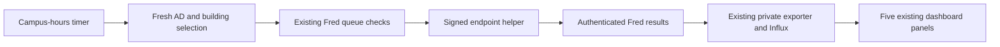

# Endpoint timing collection — October 30, 2026

The current LibreSpeed V2 reports do not contain DNS, TCP, TLS, TTFB or HTTPS
request loss. The last external timing report was October 27; the last Fred
request-loss report was October 29 at 00:48 CDT. Those reports fell outside the
dashboard's 24-hour range. The operator requested collection of the missing
measurements.

The separate `sccc-diagnostic-timing.timer` checks every two minutes from
07:00 through 19:58 America/Chicago. It queues at most one existing bounded
probe when no measurement is running and no timing job is already queued.
Devices with queued speed jobs are excluded without blocking idle receivers.
Each currently network-
confirmed building gets external-quick and Fred request-loss evidence when its
last sample is over six hours old. It selects a recently checked-in, enabled,
enrolled, AD-verified receiver, rotates among devices, backs off failed attempts
for thirty minutes, and limits this collector to 128 jobs per rolling day.
Offline buildings remain unmeasured.

External-quick uses the existing approved HTTPS origin and 5 MiB transfer.
Fred request loss uses five HTTPS requests and the existing bounded 8 MiB
download plus 8 MiB upload. This is HTTPS request failure percentage, not ICMP
packet loss. All existing queue, daily external byte budget, claim concurrency,
location, device capability, receipt and audit checks remain in force. These
small-transfer rates are excluded from the validated LibreSpeed speed panels.
Disarming the existing diagnostics rotation also stops new timing jobs.

The runner is compiled separately against the authoritative deployed Fred
source. It does not replace the API bundle, endpoint helper, or in-progress API
source. Build with `node deploy/building-diagnostics/build-timing-rotation.cjs`;
run with the existing protected API environment files. Without `--apply`, it
only reports the proposed selection. Never copy environment values into logs.

Focused verification: `node --test deploy/building-diagnostics/timing-rotation.test.mjs`.
The six tests cover freshness, pending work, daily limits, failed-probe backoff,
AD/location/receiver eligibility, and external capability/target requirements.

Rollback: disable `sccc-diagnostic-timing.timer`. Cancel any remaining jobs
whose `requested_by` is `approved recurring timing and HTTPS request-loss probes`
through Fred's normal cancellation path if immediate cessation is needed.
Completed measurements remain in the existing reporting pipeline.

## Deployment and verification

- Enabled the timer on app-server2 on October 30. The runner is
  `/home/scccadmin/insights-timing-20261030/timing-rotation.cjs`, SHA-256
  `60dc903c81ab31bb6ffc3bb5570fd8b2fe026a726cf041089c39206e6e687de4`.
  The production API bundle and private exporter were not replaced or restarted.
- Both pilot jobs completed on `LP-4Y32N64`, network-confirmed in Allied Health.
  The external probe returned HTTP 206 with DNS 133.0835 ms, TCP 54.2797 ms,
  TLS 576.8149 ms and TTFB 92.0788 ms at 10:59:14 CDT. The Fred probe recorded
  0% HTTPS request loss at 11:02:41 CDT. A following external sample also
  completed in Cosmetology.
- Verified all five existing panels contain fresh data in Grafana's **Last
  24 hours** view, after the private exporter completed its normal cycle.
  Its five-minute timer includes roughly three and a half minutes of SNMP
  collection before pulling endpoint results; an initial delay was normal
  processing, not an exporter failure. No NOC configuration was changed.
- Six focused selection tests passed, the compiled runner passed Node syntax
  verification, both systemd units passed validation, and API health remained OK.
  This verifies initial samples and enabled rotation, not complete coverage of
  every computer or building.
