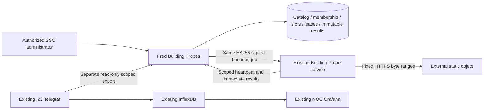

# Selected building monitoring: staged review, 2026-10-25

Implementation direction is consolidated by the ClearPass Migration thread. This branch starts directly at retained Fred commit `b763935`; the Windows branch starts at `367e133`. It extends `/network/building-probes`, `/api/building-probes`, the existing ES256 contract and `SCCCBuildingProbe` service. The divergent diagnostics prototype, saved at `d1880af`, is frozen evidence, not a feature dependency to merge or deploy.

## Agreed behavior

Select one or two low-use computers per explicit canonical building. Membership persists until an administrator changes it. Initial scope is LP-AA152MB-01 and LP-F6K6S64 only; their building must be explicitly assigned, never inferred from names, users or uplink MAC tables. Immutable catalog IDs preserve membership independently of physical correlation. Current computers, adapters and jobs are unique; replaced/revoked assignment history is separate.

| Test | Cadence | Maximum payload | Absolute test duration |
|---|---|---:|---:|
| Quick | Every 5 minutes per selected PC | 5 MiB (5,242,880 bytes) | 10 seconds |
| Hourly | Every 60 minutes per selected PC | 64 MB (64,000,000 bytes) | 10 seconds |
| Capacity | Once per building at 07:00 and 19:00 America/Chicago | 10 GB (10,000,000,000 bytes) | 900 seconds |

Device cadence uses a persisted activation anchor and selection generation; it does not pick a new random interval each run. Selection initiates a lightweight baseline. Hourly replaces a coincident quick slot. Capacity alternates between the building's eligible selected computers, with one alternate attempt if the first device is unavailable. Capacity supersedes smaller tests on the same PC. Missed offline slots are recorded and never replayed as a backlog.

Capacity start offsets are stable per building from 00:00 through 44:59 after 07:00/19:00. Admission must occur before :45; a 900-second absolute deadline keeps admitted jobs within 08:00/20:00. There is one capacity lane for the pilot, at most one per building, and a configurable production hard maximum of two. A building without an available capacity lane is visibly skipped for that window; no hours-long queue is hidden behind the schedule.

Quick work has its own highest-priority semaphore, configurable up to four campus-wide transfers, at most one per building and one per device. Hourly work uses separate lower-priority lanes: one initially, hard maximum two after headroom review. Capacity uses its own lanes. Neither hourly nor capacity can occupy a quick lane. The full configured ceiling is four quick plus two hourly plus two capacity transfers; with only the two named pilot PCs, per-device exclusion limits actual concurrency to two.

At the ten-second quick timeout, 52 simultaneously due probes require 13 waves at four quick transfers per wave: approximately 130 seconds of transfer service time, leaving 170 seconds for bounded dispatch overhead inside five minutes. A single quick lane would need 520 seconds and cannot meet that target; it is not the retained policy. Normal activation anchors spread traffic. Contention, dispatch delay and outages still produce explicit late/missed/freshness indicators rather than a guaranteed throughput SLA.

At 500 Mbps a complete 10-GB transfer takes approximately 160 seconds before overhead: 26 buildings need 69 minutes 20 seconds in one lane, or 34 minutes 40 seconds of aggregate two-lane time. At 100 Mbps those figures become 346 minutes 40 seconds and 173 minutes 20 seconds. Stable staggering and contention limits protect the network; they cannot guarantee complete coverage in a fixed window at degraded speed.

The quick test offers a short path sample, not a saturation claim for a 10-Gbps circuit. Measured bytes and elapsed time determine Mbps; negotiated NIC speed remains separate. A 10-second cutoff reports the bytes actually received and termination reason. HTTP errors, malformed/truncated ranges and unavailable targets are failures, not zero-Mbps successes.

## Target and traffic evidence

All profiles reuse `https://markb855.sg-host.com/probe-1gb.bin`. Capacity consists of nine complete 1,073,741,824-byte ranges plus a final 336,323,584-byte range under one logical job. Segments use unique job/ordinal query values, identity encoding and explicit no-cache/no-store headers. No cookies, device bearer, scripts or arbitrary targets are sent to the external host. The client binds its selected adapter, validates public destination addresses, uses normal TLS, rejects redirects and validates each Content-Range and received byte count. All connection/header/segment work shares one absolute deadline.

A bounded read-only readiness request using the planned application User-Agent returned HTTP 206, exactly 1,024 bytes, `Content-Range: bytes 0-1023/1073741824`, binary content, no content encoding and no-store response headers. The generic PowerShell request received 403; the actual application header profile is therefore part of the readiness contract. This establishes observed HTTP behavior, not knowledge of SiteGround's internal implementation. No 10-GB readiness transfer has been run.

Nominal full-payload schedule bounds, before capacity replaces coincident smaller tests and before a capacity failover:

* Each PC: 264 quick slots plus 24 hourly slots = 2,920,120,320 bytes/day.
* Two-PC, one-building pilot: 5,840,240,640 bytes plus 20 GB capacity = approximately **25.84 GB/day**.
* Illustrative 26 buildings / 52 selected PCs: approximately **671.85 GB/day**.
* Conservative bound counting all 288 quick slots as well as hourly and capacity: approximately **678.39 GB/day** for that campus illustration.

The directing thread requires a strict **10,000,000,000-byte aggregate budget per canonical building/window**. Primary and alternate child attempts share one logical capacity job. Validated terminal bytes and outstanding signed reservations remain charged to that window; only an undispatched assignment or a trusted terminal accounting result may release unspent allowance. Lease expiry or a lost report never frees potentially consumed bytes. A partial terminal attempt gives an alternate only the remaining allowance; a completed full budget permits reporting retries only. Failover cannot reset the original aggregate deadline or make the total exceed 10 GB. The nominal daily figures above therefore remain the intended payload ceiling; this follow-up replaces the earlier full-budget-alternate design.

The aggregate deadline starts with first dispatch and is at most 900 seconds, also clamped to 08:00/20:00. All child attempts share it, with smaller signed byte/time allowances as necessary. Unknown terminal accounting holds the reservation and is an operational fault, not permission to start a second full transfer. Per-attempt identity and device attribution remain available separately from the one logical building-window result.

These are payload calculations, not observed wire traffic or an assertion that every building has an eligible probe. Protocol overhead is additional. Time cutoffs, replacement and skipped slots reduce actual use. Campus headroom and hosting behavior must be measured in the reviewed pilot before enabling a second capacity lane or expanding membership.

## Contract and NOC integration

Credential enrollment/revocation and performance membership are separate. Deselection increments the generation, cancels queued/running measurements and fences late results; it retains the device credential and lightweight heartbeat. Old 0.1.2/0.1.3 workers never receive throughput unless they explicitly advertise the new capability. Service upgrades preserve existing identity/DPAPI/replay state. No alert receiver, personal MFA, network-device setting or existing wireless measurement/sidecar is changed.

The existing API adds an explicit building catalog, selection mutation, typed `throughput` jobs, selection/cancellation controls in heartbeat and a separate read-only result export. Signed job options carry a fixed target ID, profile, byte/time limits, selection revision and original slot. Quick/hourly signatures last at most 180 seconds; capacity at most 930 seconds. A short renewed server lease and continuing control heartbeat prevent a long transfer from running through disarm/deselection. Completed results upload immediately, with durable acknowledgements/retries.

`GET /api/building-probes/results/export` accepts either a stable append-only `after` cursor or a bounded `recent=true` pull. It returns immutable original sample times and a sample ID derived from job ID, device ID, test type and original sample time. Capacity records carry a shared logical capacity ID plus child attempt IDs. The bounded `capacityWindows` projection preserves validated/reserved/remaining bytes and real device attribution per attempt. Raw device secrets are never exported. The flat performance, capacity-window and health projections use the same Telegraf HTTP response; the input-only [configuration example](../deploy/building-probes/telegraf-http.conf.example) reuses existing Influx outputs. No second worker, coordinator, SNMP stack or dashboard is introduced.

Storage remains inside the retained feature: `building_probes` and `building_probe_jobs` gain membership, generation, scope and terminal-accounting fields; `building_probe_buildings`, `building_probe_slots`, `building_probe_campus_lease` and `building_probe_result_exports` hold the explicit catalog, persisted slots/window ledger, lane reservations and immutable samples. The capacity slot has a unique logical UUID and a database constraint preventing negative or over-10-GB validated/reserved totals. The first terminal accounting payload is immutable even when its count is unknown; changing a retry cannot release a reservation.

The HTTP input example follows the [official Telegraf JSON v2 object/timestamp format](https://docs.influxdata.com/telegraf/v1/data_formats/input/json_v2/). Plugin/version compatibility still requires the live acceptance step below.

The stateless Telegraf example pulls the latest 1,000 results every 15 seconds. Retries preserve original sample times, device/building/profile tags and job/sample identities; arrival time does not create duplicate performance observations. Job/sample IDs are fields rather than unbounded series tags. Capacity aggregates use building/window identity rather than inventing a physical device. Health observations carry their own observation time, sample age, offline/stale/missed flags and consecutive failures; they never fabricate zero-Mbps performance points. At 52 selected PCs the bounded performance window covers roughly 96 minutes; longer NOC outages require explicit cursor backfill from Fred. API receipt is not proof of a Grafana point: the live acceptance test must read back original timestamps and values from Influx and the intended Grafana panel.

## Activation and rollback

All independent gates default off: `BUILDING_PROBES_ENABLED`, `BUILDING_PROBE_SCHEDULER_ENABLED`, `BUILDING_PROBE_THROUGHPUT_TARGET_READY`, and the Windows capacity permission. Default capacity concurrency is one, with a hard maximum of two. No source commit enables these values on a live server. No production table migration, service restart, Windows upgrade, timer, credential rotation or old-helper cleanup is part of this staging task.

Before any live action, the directing thread reviews changed files, test/build evidence, this contract, exact traffic/concurrency policy and rollback. Reconcile fresh live hashes; do not deploy retained baseline reconciliation commits wholesale over the frozen prototype. Back up only affected files/release and configuration, retain existing signing/identity state, and upgrade the two named workers before enabling throughput capability. Verify both services and adapters, cancellation/deselection, result identity, original-time Influx ingestion and the actual Grafana view.

Rollback first disarms scheduler and target readiness and confirms running-job cancellation. Keep the new API available while 0.1.4 workers drain/acknowledge pending throughput results; then back up protected state and restore worker binaries if required. An older worker cannot preserve the new throughput result metadata when reserializing an undrained queue. An older strict API also rejects the new snapshot fields, so restore the older API only after the worker rollback is complete. Enrollment and existing alert/MFA services remain intact. Retain additive catalog/history/result tables for audit; do not drop data. The frozen prototype is retired only after controlled migration acceptance.

## Staged validation

* Fred: **62 targeted tests passed**, including 21 real PostgreSQL tests in the isolated loopback-only `buildingprobetest` database, 12 HTTP/auth tests, 10 scheduler/allocator checks, seven identity checks, nine metrics-projection tests and three budget-helper checks. Strict-budget cases include concurrent reservations, a 3-GB primary plus 7-GB alternate, unchanged aggregate deadline, immutable unknown terminal retries, retained unknown reservations, reporting-only completion retries, unsigned reassignment and a clamped initial lease. API production build passed; no `building_probe` TypeScript diagnostics were reported; the scratch cluster was stopped. This is not a claim of a repository-wide clean typecheck.
* Windows: **127 checks passed** (17 retained plus 110 new), with no C# compiler warnings. Synthetic streams counted a 10-GB result without downloading or allocating a 10-GB payload. Scope includes binary/range/size/time limits, disguised HTML, cancellation, absolute lease/RTT fencing, delayed slot delivery, replay/state migration, concurrent ACK/state safety and immediate result delivery. Child attempts honor smaller allowances and the original deadline. Only exact stopped completion or proven zero-byte preflight asserts terminal accounting; uncertain partial bytes remain reported with their full reservation charged. Build-script syntax and affected-file whitespace checks passed.
* Portal: production build and 11 synthetic browser fixtures passed. Root visual review caught and corrected an hourly-per-building wording error; hourly behavior is per selected computer. The existing fixed sidebar clips the page at a 390-pixel viewport, so these functional checks do not establish mobile visual acceptance. Shared app layout was left outside this focused change.
* HTTP readiness: one 1,024-byte range request passed with the planned application headers. Full real-target profile runs have not been performed.
* Telegraf example: TOML syntax parsed (one HTTP input, three parser projections). It has not been loaded into the running `.22` Telegraf version; native parser compatibility, health/freshness ingestion, Influx point read-back and the intended Grafana panel remain live acceptance checks.

Exact final commits, changed files and source/build hashes are recorded in the directing-thread handoff. This document is not evidence of deployment or end-to-end monitoring.
