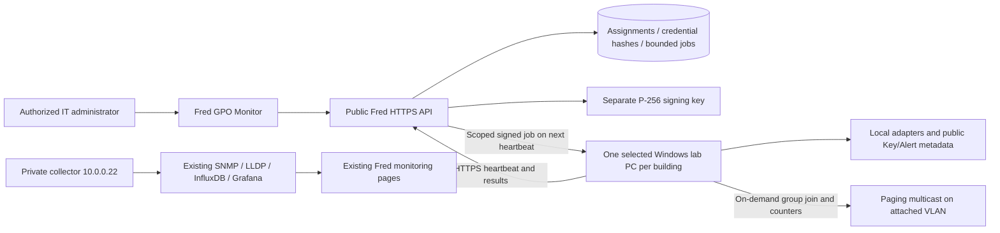

# Selected building probes / SCCC Key & Alert GPO monitor

Prepared 2026-10-25. Source and packages are built for review; production activation and a physical building pilot are separate steps. No network-device changes are required by this app.

## Behavior

`/network/building-probes` adds **GPO Monitor** to Campus Technology. The existing restricted SCCC Key alert console links to this page. Fred's existing sign-in remains authoritative: CIO selects/revokes computers; CIO/network/network_engineer can view reports and request tests. A probe credential cannot call administrator, alert or MFA APIs.

One enabled assignment per normalized building name, and one enabled building per computer name/device UUID, are enforced by database indexes. Revoke an assignment before replacing it. Enrollment uses a single-use, 20-minute bootstrap secret bound to the selected Windows computer name; this is possession-based provisioning, not an AD attestation. Store downloaded files where only administrators and that selected computer account can read them. Device credentials are SHA-256 hashes in PostgreSQL; the client persists its own proposed credential before enrolling so a lost response is safely retryable.

Every 60–70 seconds, the selected PC sends its adapter IPv4/prefix, MAC, gateway, DNS/DHCP, link speed, uptime, probe version, and public SCCC Key/Alert installation/process/receiver-service status. An active service/process is not proof of alert delivery, MFA health or a signed-in user. Five minutes without a server check-in produces **stale**, not healthy. Only the latest snapshot and 50 recent jobs per assignment are retained.

Two on-demand jobs are supported:

* **Network:** up to three gateway pings, Fred DNS resolution and an authenticated HTTPS check. DNS/HTTPS use the Windows routing table; gateway ICMP can be blocked without implying a network outage.
* **Multicast:** join `239.0.1.216:24016` for up to 60 seconds on the selected adapter, count packets from `10.40.4.20`, and check the kernel-reported destination and receiving interface. No audio/payload is saved. `no_packets_observed` is inconclusive. An optional expected voice subnet produces `wrong_network` before listening if the adapter is outside it. Packet receipt verifies only this PC's adapter, never phone playback.

Jobs contain no shell command, script, arbitrary URL or host. They are P-256 signed, expire after 180 seconds, and bind to both assignment and device UUID. The endpoint reserves job IDs durably before execution and keeps at most 20 pending results. Enrollment retry, job result acknowledgement and revocation are separate from SCCC Alert identities/credentials.



The new endpoint does not contact `.22`, perform SNMP, expose SNMP credentials, invoke Fred AI, or change switch/firewall settings. Existing central telemetry remains a separate source; automatic MAC-to-switchport correlation is not implemented by this initial probe release.

## Server preparation and rollout

1. Back up the current release and affected files. Recheck live hashes against the production baseline before applying the narrow feature commit. This branch's two earlier baseline commits capture live source and remove GitHub-only files absent from production; they are not feature changes to deploy wholesale.
2. Build libraries, API and UI using the deployed Linux toolchain and frozen lockfile. Full API/UI builds pass. Repository-wide TypeScript checks still report existing errors in AI/network-map/reporting code; the new probe files have no reported type errors. Do not describe the whole repository as type-clean.
3. Create a key **outside the release/web root**, in a private service-owned directory, using `node artifacts/api-server/src/scripts/create_building_probe_key.mjs /absolute/private/path/probe-signing.pem`. It refuses to overwrite a key. Back it up with restricted permissions. Do not commit it.
4. Configure the API service environment (existing PostgreSQL pool is reused):

   ```text
   BUILDING_PROBES_ENABLED=true
   BUILDING_PROBE_PUBLIC_ORIGIN=https://app-server2.centralus.cloudapp.azure.com
   BUILDING_PROBE_SIGNING_KEY_FILE=/absolute/private/path/probe-signing.pem
   ```

   With the flag absent/false, agent enrollment and jobs are disabled and the authenticated monitor shows an inactive state. Tables are created lazily only when enabled probe storage is used. The existing service account needs normal create-table/index permission for this first initialization; no existing tables are altered.
5. Deploy the reviewed API/UI artifacts through the existing `sccc-api` service, and the SCCC Key `public/admin.html` link through its normal release path. Preserve its existing server/receiver code. Restart only through the service manager, then read back the actual monitor URL and authenticated API. Do not launch another production API process manually.
6. Select the first building and its actual computer name. Download the one-time provisioning file, then follow the SCCC-Key `windows/deployment/BUILDING-PROBE.md` guide. The Windows package alone is inert.
7. Require the target to show **reporting**, verify the actual adapter/subnet and Key/Alert snapshot, then request a network check. For paging, wait for **dispatched**, then send the test page during the 60-second window. Check timestamps, adapter, source, counters, and independently verify a phone hears the test. Test revoke/uninstall before wider GPO use.

Key rotation requires reprovisioning selected endpoints with the new public key; preserve the current key until that controlled rollout is complete. Revoking a device immediately rejects future API requests and cancels queued jobs; an already running 60-second capture can finish locally but cannot upload after revocation.

## Rollback and validation

Set `BUILDING_PROBES_ENABLED=false`, restart the managed API, and restore backed-up affected API/UI files or the prior release. Revoke targets before removing their services with the provided Windows uninstall script. Retain restricted assignment/job records for review; no database drop is necessary. Existing Key/Alert services and network configuration are unchanged.

Verified locally: 16 API/protocol/store boundary tests (mocked PostgreSQL adapter), 17 Windows authorization/scope/adapter/snapshot checks, 4 browser tests (desktop, narrow viewport, disabled mode, target provisioning/download), API/UI production builds, and the existing Key suite (54 tests plus JS syntax check). The signed MSI is verified by Authenticode and administrative extraction; no Windows service was installed by these checks. Real PostgreSQL concurrency, target-machine SYSTEM/UNC access, installation/recovery/restart/uninstall, live multicast reception, and physical phone playback remain pilot acceptance checks.

The probe embeds .NET 10.0.13 LTS. Self-contained endpoints need no preinstalled runtime, but packages must be republished for subsequent security patches; see the [Microsoft support policy](https://dotnet.microsoft.com/en-us/platform/support/policy).
