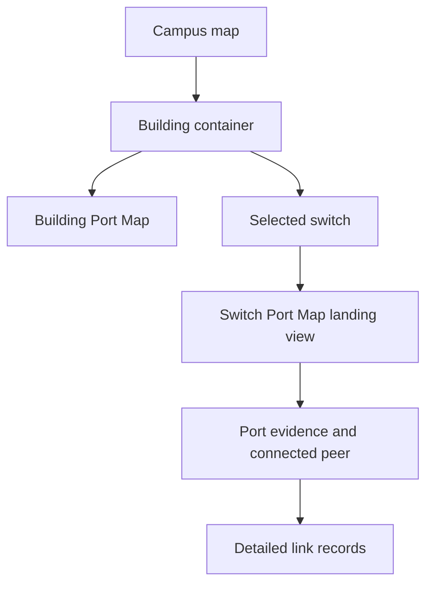
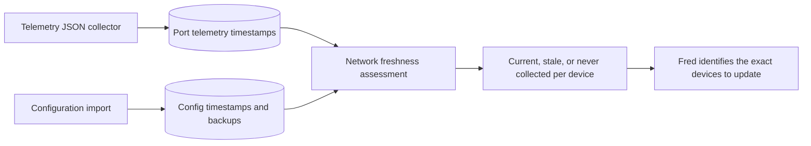
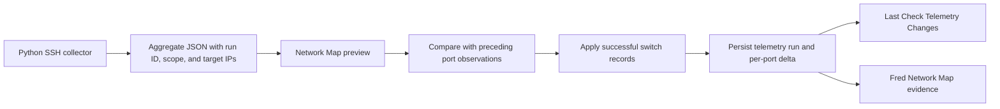

# Network drill-down and evidence freshness

The network experience follows the way technicians narrow an incident:

Visualizer building containers are sized from their current children. Saved
positions remain useful, but historical container dimensions are ignored so a
new switch or VLAN cannot render outside its building boundary.

Legacy Student Living labels such as `Student Life AB`, `Student Life DE`,
`SWA-SLAB`, and `SWA-SLCDE` resolve to the canonical **Student Living Center**
building. The original hostname and room/section remain on the device record;
canonicalization changes grouping only.

Fred receives freshness metadata whenever she queries the Network Map overview:

- Telemetry becomes stale after 36 hours because the expected collection is
  nightly.
- Configuration evidence becomes stale after 90 days and should also be
  refreshed immediately after an approved configuration change.
- Missing evidence is reported as `never_collected` or `not_imported`; it is
  never interpreted as a healthy or known-good device.

## Telemetry run history and delta

Every telemetry file declares its collection scope and exact target IPs. A
targeted run is `partial`; an inventory-wide run is `full`. Files created by
older collectors without an explicit scope are treated as `partial` because
scope must never be guessed from the number of records.

Import is strictly target-scoped. Only switches present in the file may have
their telemetry updated. A switch omitted from either a partial or full run is
not changed, marked stale/down/bad, retired, or deleted. Failed or omitted
targets remain inventory records, and retirement/deletion always requires a
separate explicit authorized action. Fred may report a device's independently
calculated evidence age, but must not describe it as a consequence of a scoped
upload.

For a switch with no preceding stored physical-port telemetry, the import is an
initial baseline. Its ports are stored, but they are not reported as newly
added or changed. Delta reporting begins with the next collection.

The JSON import previews every physical interface against its preceding stored
telemetry observation. Applying the import records the collector `run_id`,
timestamps, failed targets, aggregate counts, affected devices, and individual
operational, administrative, native-VLAN, description, newly observed, and
missing-port changes.

An observed up/down delta is historical evidence, not an outage declaration.
Fred must cross-check Monitoring or an approved live probe when a user asks
whether a service or port is currently operational.

## Building-health evidence rules

The building stored on the maintained switch/node record is authoritative.
Collector-provided building text and hostname/location heuristics may identify
a mismatch for review, but they cannot relocate an assigned switch. Manual
node edits synchronize the switch inventory record, and ordinary switch
inventory edits synchronize the matching physical topology node. Both paths
create an attributed inventory-audit entry, so the Network Map, Buildings view,
and Fred read the same assignment. Name heuristics are limited to genuinely
unassigned legacy records. A disagreement between the two maintained stores is
reported separately from a collector disagreement.

Retiring a maintained switch requires an explicit confirmation. The retirement
transaction records the actor and before-state, removes matching topology
nodes, ports, links, routing adjacencies, and layout projections, then removes
the maintained inventory row. Configuration backups remain stored with their
switch reference cleared; deletion audits are evidence and are not offered as
an automatic rollback.

The campus map must distinguish **service state** from **evidence coverage**.
An unavailable current probe is not a degraded device. Building health uses
evidence in this order:

1. a current observed Influx or approved probe result;
2. the latest stored/imported telemetry observation, with its collection time;
3. the explicit inventory state only when it represents an attributed
   observation rather than a default value; or
4. `unknown` when none of those sources observed the device.

Unknown devices do not turn a building amber. If all devices are unknown, the
building is gray/unknown. If the known devices are up and the remaining devices
are unknown, the aggregate service state stays green. Amber or red requires an
observed or maintained degraded/down result; historical fallback evidence must
retain its source timestamp so it is not presented as real-time telemetry.

Port telemetry is a collected snapshot, not a continuous live feed. An unused
access port that is administratively enabled and operationally down is normal
unless there is additional evidence that it should be carrying service. The
Port Map and Fred's `issuesOnly` view treat a port as actionable when supported
by evidence such as a new up-to-down delta, a trunk/uplink or known topology
peer that is down, a critical/E911 assignment, errors or discards, excessive
utilization, or an explicit optics alarm. Missing optional DOM readings are an
enrichment gap, not an alarm, and copper ports are never expected to provide
DOM values.
