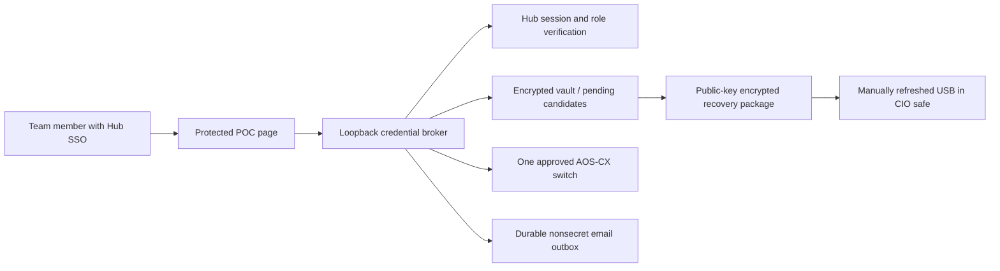

# Fred credential-access proof of concept

Approved first live target: **AA151-CIO, 192.168.252.173, existing `admin` account**.
Mark supplies the initial password through `Default_test_user` / `Default_test_pass`
in the existing, untracked `C:\Code\Aruba\.env`. Values never enter source, chat,
terminal output, URLs, email, or the AI knowledge base. After checkout is returned,
the pilot deliberately replaces that initial password with a unique generated one.

This is an isolated sidecar and page alongside the Reporting Hub. It does not
replace the Hub's mismatched source or change Fred's model instructions. The model
tool integration is a subsequent step: tools return a protected reveal action and
nonsecret results; the model must never receive the reveal response's password.

## Authentication and scope

Every API call validates the existing Hub bearer session through its fixed local
`/api/auth/me` endpoint. The returned user must be active, Entra-linked, not a
break-glass user, and have CIO/network/network_engineer role. Only the CIO may
enroll a target, view the owner audit, or test recovery. Caller-supplied names or
roles never authenticate a request. The current Hub blocks local login for
non-break-glass users, so these eligible users must sign in through SSO.

The device adapter is hard-limited to the approved IP, AOS-CX, and existing admin
account. All other devices—including firewalls, Nexus, DNS and DHCP—remain outside
this live pilot. No personal account, port, VLAN, routing, SNMP, or firmware change
is made. Management SSH host keys must already be trusted.

## Lifecycle and failure behavior

1. Verify old administrator login; stage old and initial passwords encrypted.
2. Persist applying state and encrypted configuration backup before mutation.
3. Change the password through masked AOS-CX prompts, prove fresh privileged login,
   save configuration, and prove another fresh login.
4. Record issuance and a durable email obligation before revealing a credential.
5. On return, persist a generated 32-character candidate before device I/O, change,
   save and verify, then mark it current and refresh the recovery package.
6. A failed change attempts restoration through the original session. Any failure
   leaves current/candidate encrypted and blocks further checkouts for review.
   A process lost in applying state likewise blocks further access until review.

Pending email events survive restart and can be retried. A transport failure does
not erase an issuance or claim email was sent. SMTP acceptance is not proof of inbox
delivery. Exactly-once delivery cannot be guaranteed across an SMTP/process crash;
stable Message-IDs allow duplicate identification. The single-process server and
OS vault lock serialize operations. Do not run multiple sidecars against one vault.

## Encryption and recovery

Vaults/configuration backups use AES-256-GCM with random nonces and atomic writes.
Runtime keys use CurrentUser DPAPI on Windows; on the Linux service they are stored
in a mode-0600 key file inside the mode-0700 state directory. The runtime service
must be able to unlock credentials, so service-account/root compromise remains
outside encryption-at-rest protection. No decrypted configuration is written to
disk. A previous password is retained encrypted for this pilot's recovery review.

Each state update creates an independently wrapped recovery package using an
RSA-3072 public key, RSA-OAEP/SHA-256 and a fresh AES-256-GCM key. Its private key is
encrypted PKCS8 with a separately generated unlock password. Recovery testing uses
the private-key path, without the normal runtime AES key or SSO. It verifies
decryption/freshness; actual console access during an outage still needs a drill.

For the office safe, copy `safe.recovery.json`, `recovery-private.pem`, the standalone
`recover_offline.py`, this runbook, and prepared dependencies/recovery laptop to USB.
Print the unlock password locally using `prepare_safe.py` (never in chat/logs), and
seal it separately with the USB in the office safe. Test the copied package on the
recovery laptop with networking off. The USB's version must match the live version;
an unplugged USB cannot refresh automatically. Record physical refresh explicitly.
The online private key/unlock are staged for this POC; move custody offline after
acceptance. Continue public-key exports after that, testing recovery offline.

## Validation and rollback

Run `python -m unittest -v test_broker.py` from this folder. Tests exercise real
encryption, independent recovery, borrower attribution, authorization, concurrent
checkout prevention, failure after device mutation, failed persistence before
mutation, notification retry, and tamper/wrong-key rejection.

Deployment adds only the dedicated `fred-credential-poc` service, its private state,
a static page, and two narrow nginx locations. Validate nginx before reloading.
To remove the POC UI, stop its service and restore only the backed-up nginx files.
**Keep the encrypted state and recovery package:** removing the UI does not restore
a device password. Restore the account only via a controlled verified rotation;
never assume service rollback undoes a password change.

